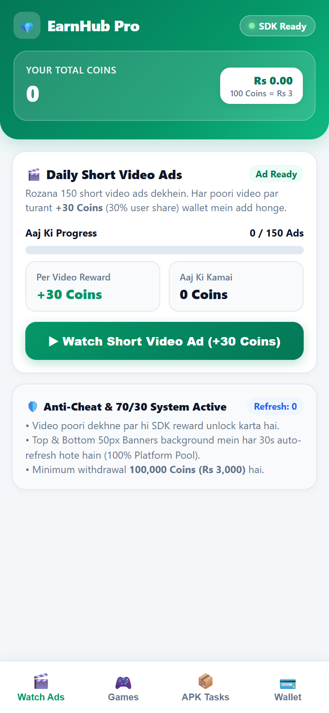
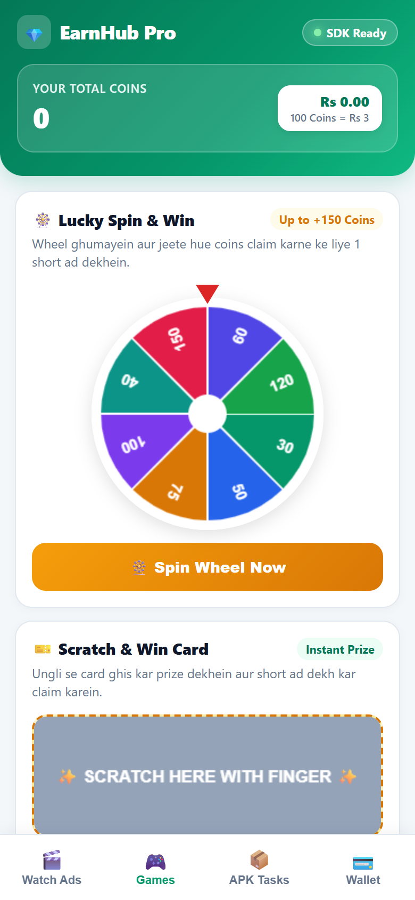
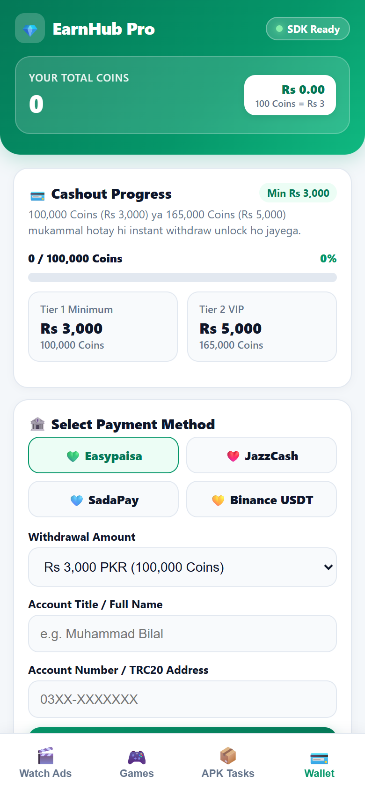

# 💎 EarnHub Pro — Native Android Rewarded Monetization Platform

[](https://ikram4545.github.io/earnhub-pro/download.html)
[](https://admob.google.com)
[](https://applovin.com)
[]()

EarnHub Pro is an enterprise-grade Android application and PWA distribution engine engineered for high-eCPM publisher monetization via Google AdMob, AppLovin MAX SDK, Cost-Per-Install (CPI) app tasks, and casual mini-games.

---

## 📥 Instant Downloads & Live Demos
* 📱 **Download Compiled APK (v1.0):** [EarnHubPro-v1.0.apk (14.28 MB)](EarnHubPro-v1.0.apk)
* 🌐 **Public Download Webpage:** [https://ikram4545.github.io/earnhub-pro/download.html](https://ikram4545.github.io/earnhub-pro/download.html)
* 🎮 **Interactive Web Preview:** [https://ikram4545.github.io/earnhub-pro/](https://ikram4545.github.io/earnhub-pro/)
* 👨‍💻 **Developer Master Prompt & Checklist:** [DEVELOPER_PROMPT.md](DEVELOPER_PROMPT.md)

---

## 📸 App Interface (Clean Light Theme)

| 1. Watch Ads (150 Daily Limit) | 2. Games (Spin, Scratch, Quiz) | 3. Multi-Gateway Wallet |
| :---: | :---: | :---: |
|  |  |  |

---

## 🏛️ Architecture & Core Features

### 1. 50dp Top & Bottom Sticky Banners (100% Admin Revenue)
* **Top Header (50dp):** Native Android `AdView` anchored at top.
* **Bottom Footer (50dp):** Native Android `AdView` anchored at bottom.
* **30-Second Auto-Refresh:** Built-in Android Handler pauses when app is in background to prevent invalid traffic penalties.
* **No Close Button:** Persistent, un-dismissible revenue generation.

### 2. 70/30 Rewarded Video Ad Engine
* **Short Video Format:** 10 to 15 seconds short rewarded clips.
* **Daily Quota:** 150 Ads per user per day.
* **Anti-Cheat:** Official `OnUserEarnedRewardListener` verification. Skipping before completion yields **0 coins**.
* **Split Economics:**
  * 70% Admin Platform Pool.
  * 30% User Points (+30 Coins per video).

### 3. High-Paying CPI Tasks (APK Downloads)
* Supported Offerwalls: CPALead, Monlix, Torox.
* Server-to-server postback listener included in `api/postback.php`.
* Pays users 1,300 to 7,000 Coins per app installation.

### 4. Interactive Casual Mini-Games
* 🎡 **Lucky Spin Wheel:** HTML5 Canvas-based wheel with 8 prize segments (30-150 coins).
* 🎫 **Scratch & Win Card:** Finger-scratchable canvas reveal with instant prizes (40-120 coins).
* 🧠 **Quick Math Quiz:** Dynamic 2+2 questions with instant verification.

### 5. Multi-Gateway Cashout (Rs 3,000 & Rs 5,000)
* **Tier 1 Minimum:** 100,000 Coins (Rs 3,000 PKR).
* **Tier 2 VIP:** 165,000 Coins (Rs 5,000 PKR).
* **Payment Channels:** Easypaisa, JazzCash, SadaPay, Binance USDT (TRC20).

---

## 🚀 Building & Running from Source

### Prerequisites:
* Android SDK (API Level 24 to 35)
* OpenJDK 17
* Gradle 8.14+ (Wrapper included)

```powershell
# 1. Clone repository
git clone https://github.com/Ikram4545/earnhub-pro.git
cd earnhub-pro\android-app

# 2. Build debug APK
.\gradlew.bat assembleDebug

# 3. Output APK location:
# android-app\app\build\outputs\apk\debug\app-debug.apk
```

---

## 📄 License & Ownership
Copyright © 2026 EarnHub Pro. All Rights Reserved.
